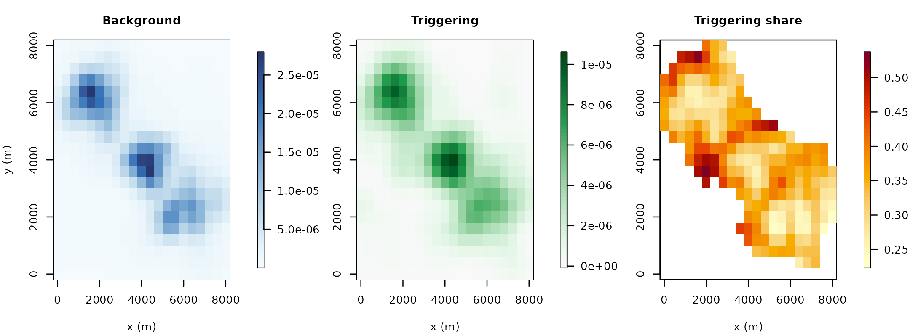

# Separating background risk from contagion

## Why bother separating them: a crime based illustration

Two neighbourhoods record the same number of homicides over a year. In
one, the events are spread through the year with no particular
relationship to each other: the place is simply dangerous, for reasons
that were true before any of those events and remain true after,
e.g. land use, guardianship, who passes through. In the other, one
shooting was followed by a retaliation, which was followed by another,
all within weeks and within close proximity.

The count is identical. The right response is not. The first calls for
sustained structural work; the second calls for rapid, targeted
disruption of a chain that is currently running. A model that reports
only intensity cannot tell them apart. That is the whole reason for
fitting a self-exciting process rather than an inhomogeneous Poisson
one.

This article shows how to get that separation out of a fitted model.

``` r

library(spHawkes)
library(sf)
```

## The two components

The fitted conditional intensity has exactly two terms:

``` math
\lambda(x, y, t \mid H_t) \;=\;
\underbrace{\mu_0\, \mu_T(t)\, \mu_m(t)\, \mu_w(t)\, \mu_b(x, y)}_{\text{background}}
\;+\;
\underbrace{A \sum_{i:\, t_i < t} g(t - t_i)\, h(x - x_i,\, y - y_i)}_{\text{triggering}}
```

Accumulating each over a time window $`\mathcal{T}`$ gives two surfaces
that add up to the total risk over that period:

``` math
\Lambda_\mathcal{T}(x,y) \;=\; \Lambda^{\text{bg}}_\mathcal{T}(x,y) \;+\; \Lambda^{\text{tr}}_\mathcal{T}(x,y)
```

$`\Lambda^{\text{bg}}`$ is the geography of persistent risk — where
events are expected regardless of what has just happened.
$`\Lambda^{\text{tr}}`$ is the part attributable to the events that
actually occurred.

## Fitting

We use the bundled simulated data
([`?sim_events`](https://henriquescadbylab.github.io/spHawkes/reference/sim_events.md)),
which was generated with a known branching ratio of `A = 0.35`. The fit
limits the triggering kernel to 1 km from each event
(`trigger_window_dist` and the kernel grid’s `x_range`), a few times the
distance at which the simulation placed offspring. A much wider reach
lets the kernel’s tail absorb clustering in the background and inflates
`A`.

``` r

fit <- fit_semihawkes(
  points    = sim_events,
  region    = sim_region,
  date_col  = "date",
  cell_size = 400,
  cache_dir = tempfile("spHawkes_marks_"),
  bandwidth_args = list(k = 5, min_dist = 150, min_bandwidth = 300),
  trigger_window_dist  = 1000,
  trigger_spatial_args = list(x_range = 1000),
  n_iter    = 12,
  verbose   = FALSE
)
```

``` r

summary(fit)
#> Semi-parametric spatio-temporal Hawkes fit
#> ------------------------------------------------------------
#> Events        : 375
#> Study window  : 2021-01-03 to 2024-01-01 (1093 days)
#> CRS           : EPSG:32717
#> 
#> Parameters
#>   mu (baseline rate)     : 3.60987e-09  per unit area per day
#>   A  (branching ratio)   : 0.3770  expected offspring per event
#>   log-likelihood         : -7150.43
#> 
#> Branching structure (from fitted background probabilities)
#>   background :    252.1 events ( 67.2%)
#>   triggered  :    122.9 events ( 32.8%)
#> 
#> Fitted components (range over their support)
#>   trend               [    0.5287,      1.377]
#>   weekly              [    0.7436,      1.322]
#>   monthly             [    0.9028,      1.166]
#>   spatial background  [   0.05576,      7.047]
#>   trigger (temporal)  [ 0.0004071,    0.07703]
#>   trigger (spatial)   [         0,  7.726e-07]
#> 
#> Convergence
#>   12 EM iterations, reached n_iter without converging
#>   final change in log-likelihood: 0.147195
```

The summary already gives the split *overall* — what share of events the
model attributes to each mechanism. What it does not give is **where**.

## Computing the two surfaces

Everything needed is on the fitted object. The background is a product
of the temporal multipliers and the spatial surface; the triggering term
is a sum over observed events of the two kernels.

``` r

grid_x <- fit$background$x
grid_y <- fit$background$y
ev     <- fit$events$events
days   <- seq(0, floor(fit$events$TT))          # daily bins over the study period

# Background: separable, so the time factors collapse to a single scalar.
time_factor <- sum(fit$trend$fun(days) *
                   fit$weekly$fun(days) *
                   fit$monthly$fun(days))
Lambda_bg <- fit$mu * time_factor * fit$background$basevalue

# Triggering: accumulate each event's kernel over the grid.
GX <- grid_x %o% rep(1, length(grid_y))
GY <- rep(1, length(grid_x)) %o% grid_y

Lambda_tr <- matrix(0, nrow = length(grid_x), ncol = length(grid_y))
for (i in seq_len(nrow(ev))) {
  g_sum <- sum(fit$temporal_trigger$fun(days - ev$days[i]))
  if (g_sum <= 0) next
  Lambda_tr <- Lambda_tr +
    g_sum * fit$spatial_trigger$fun(GX - ev$coorx[i], GY - ev$coory[i])
}
Lambda_tr <- fit$A * Lambda_tr
```

Mask to the study region, and check the split against what
[`summary()`](https://rdrr.io/r/base/summary.html) reported:

``` r

in_region <- fit$background$marks > 0
Lambda_bg[!in_region] <- NA
Lambda_tr[!in_region] <- NA

share_triggering <- sum(Lambda_tr, na.rm = TRUE) /
  sum(Lambda_bg + Lambda_tr, na.rm = TRUE)
round(share_triggering, 3)
#> [1] 0.32
```

This lands close to the
[`summary()`](https://rdrr.io/r/base/summary.html) figure above, which
is a reassuring cross-check — but note that the two are *related, not
identical*, quantities.
[`summary()`](https://rdrr.io/r/base/summary.html) averages the fitted
probability that each **observed event** was triggered; the number here
is the share of **accumulated intensity** over the whole region
attributable to the triggering term. They answer slightly different
questions and need not agree exactly. Landing within a percentage point
of each other is evidence that neither computation has gone wrong; it is
not an algebraic identity.

The *absolute* totals are less exact. Added up, the two surfaces imply
about 409 events against the 375 observed, because this is a coarse
Riemann sum over grid cells and whole days whereas the package
integrates on a finer temporal mesh internally. Read the proportions
rather than the totals.

## Where each mechanism dominates



The first two panels look similar, and they should: triggered events
happen near where events happen, so both components peak in the same
three places.

The third panel is the one that carries information the first two do
not. It is the *proportion* of accumulated risk attributable to
triggering, shown only where there is enough risk for the ratio to mean
something. Low values mark places whose risk is structural — they would
be dangerous regardless. High values mark places whose risk is
disproportionately a consequence of recent events, and where
interrupting the chain is therefore the intervention with something to
bite on.

In the paper’s vocabulary, the low-share cores are **established**
hotspots and the high-share margins are **emerging** ones.

## Reading it with care

Three caveats worth carrying.

**The share is a ratio, and ratios mislead where the denominator is
small.** Hence the masking above. Without it, the highest triggering
shares appear in the emptiest parts of the map, which is an artefact
rather than a finding.

**This is a fixed window.** Both surfaces were accumulated over the
whole study period. Computing them year by year is what turns this into
the paper’s account of hotspots that shift and reorganise, and is a
matter of restricting `days` and the event set to each window in turn.

**Attribution is model-based, not observed.** The branching structure is
latent. “This cell is 40% triggered” means the fitted model assigns 40%
of the accumulated intensity there to the self-exciting term — under
this specification of the background. A background specified differently
would move that number, which is exactly why the background’s form is a
substantive modelling decision rather than a default.

## A note on where this is going

The loop above is deliberately written out rather than hidden, because
it is short and because seeing it makes clear what the decomposition
actually is. It is, however, the obvious candidate for a
[`predict()`](https://rdrr.io/r/stats/predict.html) method — one that
takes a fit, a period and a component and returns the surface directly.
Doing it here first fixes the output and the interface in a form that
can be critiqued before any of it is committed to the package’s API.
