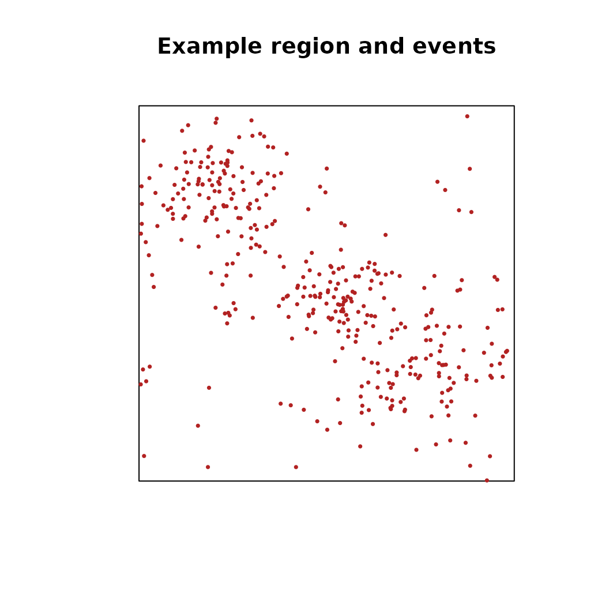
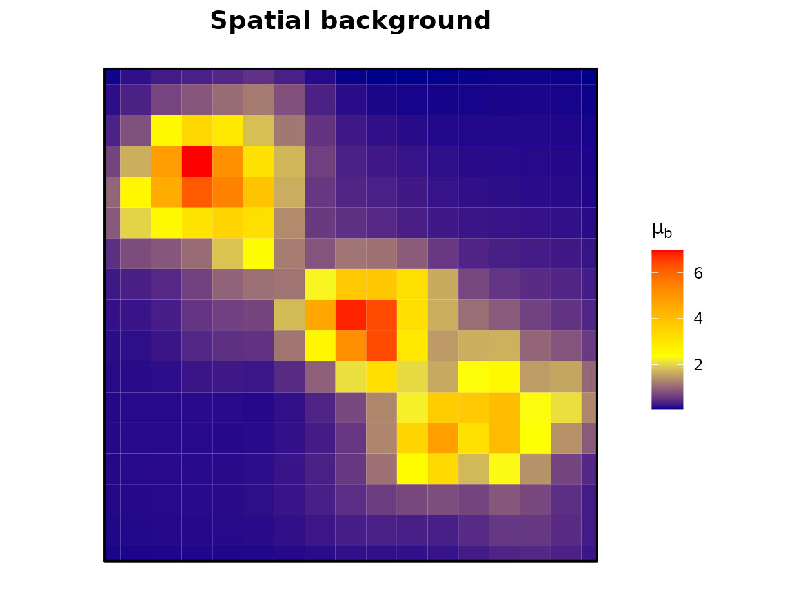
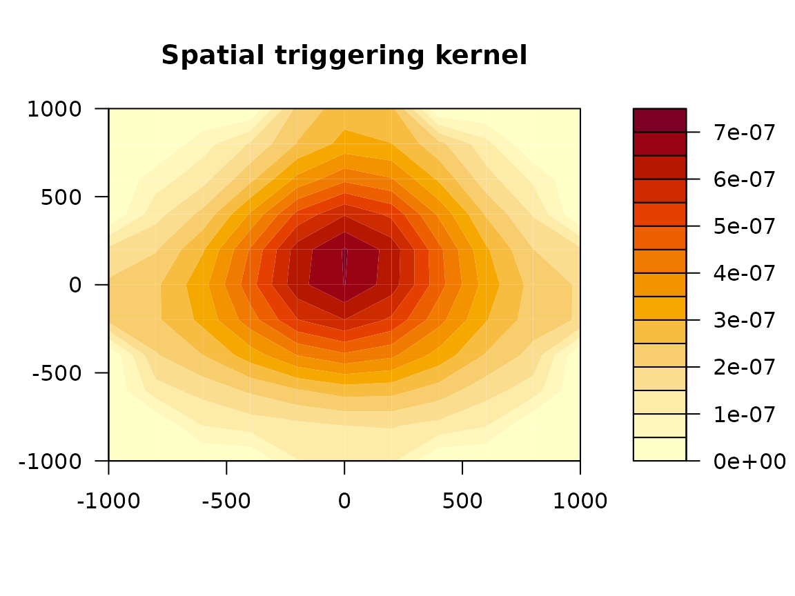
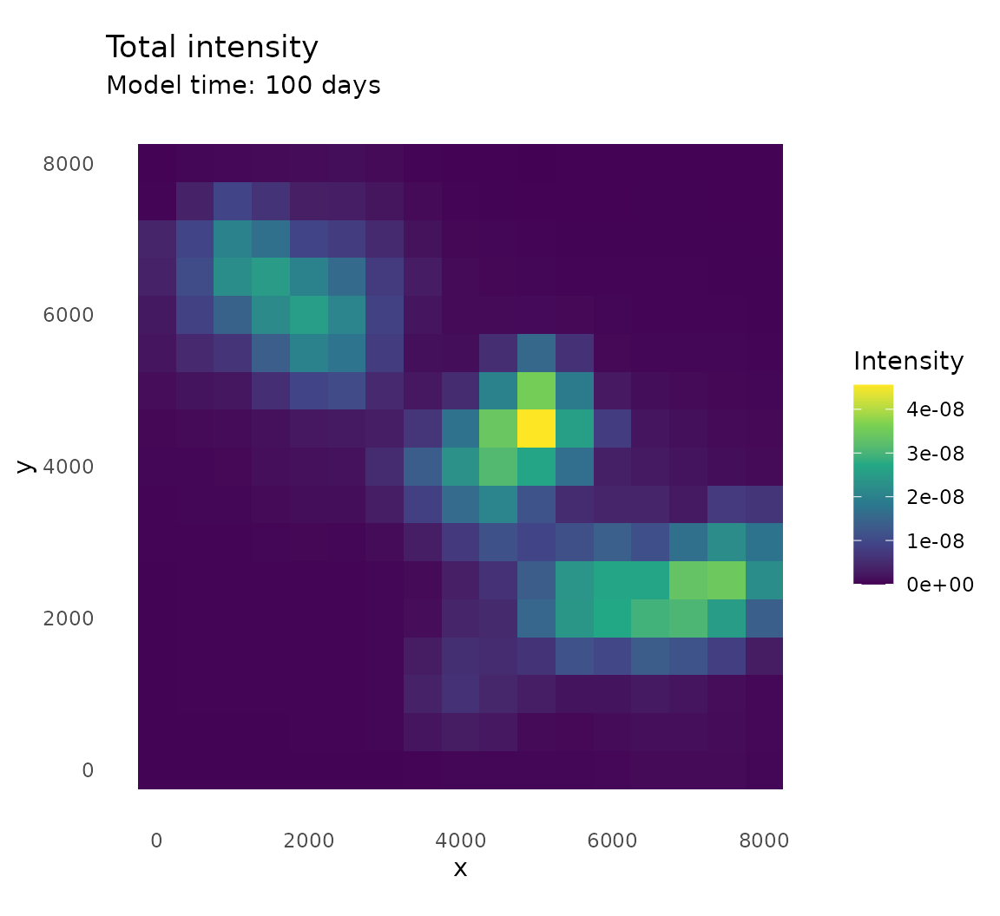
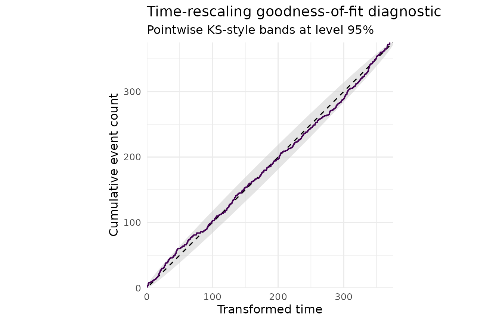
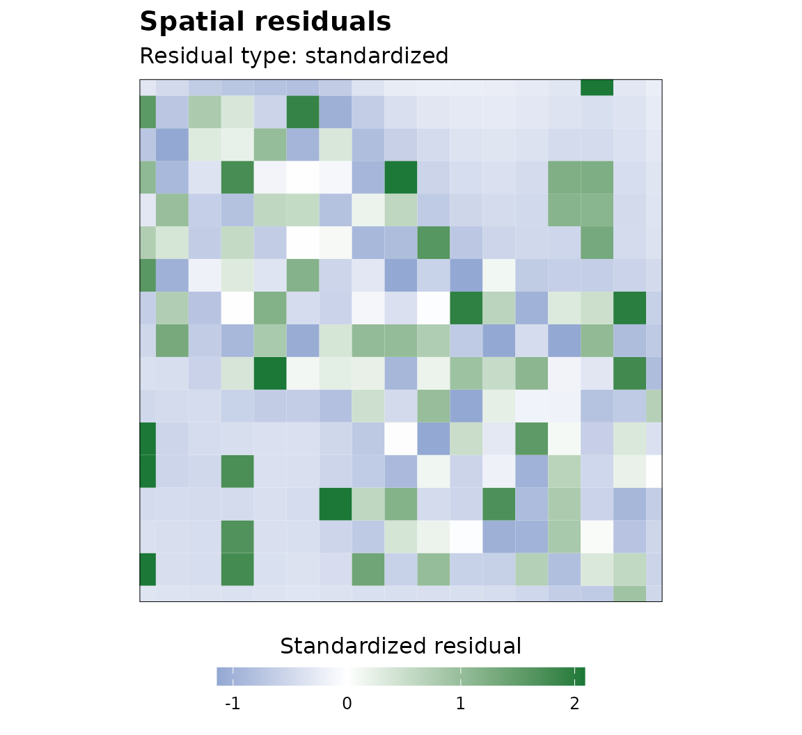

# Getting started with spHawkes

## Introduction

`spHawkes` fits semi-parametric self-exciting (Hawkes) spatio-temporal
point process models to event data. Crime records are the motivating
application, and fitting uses a stochastic-declustering EM algorithm
following Zhuang & Mateu (2019).

The model decomposes the observed event intensity into two parts:

- A **background** intensity, $`\mu(s, t)`$, describing where and when
  events occur independently of earlier observed events. The background
  is represented by a spatial surface and weekly, monthly, and long-term
  temporal multipliers, all estimated non-parametrically.

- A **self-exciting (triggering)** component,

  ``` math
  A \sum_{t_i < t} g(t - t_i) h(s - s_i),
  ```

  in which an earlier event at location $`s_i`$ and time $`t_i`$
  temporarily raises the rate of later events at location $`s`$ and time
  $`t`$. Here, $`g`$ is the temporal triggering kernel, $`h`$ is the
  spatial triggering kernel, and $`A`$ is the branching-ratio parameter.

This vignette demonstrates an end-to-end workflow on a small
**simulated** dataset bundled with the package. It shows how to prepare
point-event data, fit a model with
\[[`fit_semihawkes()`](https://henriquescadbylab.github.io/spHawkes/reference/fit_semihawkes.md)\],
inspect its components and convergence, and assess goodness of fit.

Simulated data are used instead of real data so that the example is
reproducible and practical to build during `R CMD check`. The final
section highlights the key choices needed for a real dataset.

``` r

library(spHawkes)
library(sf)
#> Linking to GEOS 3.14.1, GDAL 3.12.2, PROJ 9.7.1; sf_use_s2() is TRUE
```

## Example data

`spHawkes` expects two `sf` inputs:

- `points`: an `sf` object with one row per event, an `sfc_POINT`
  geometry column, and a date column of class `Date`.

- `region`: an `sf` or `sfc` object with `POLYGON` or `MULTIPOLYGON`
  geometry defining the study-area boundary.

Both inputs must use a **projected** coordinate reference system (CRS)
and their CRS must be identical or compatible. Kernel bandwidths and
distances use the CRS’s linear units, so the package rejects
longitude/latitude coordinates. It also warns when a projected CRS does
not use metres as its linear unit.

The package includes `sim_events`, with 375 simulated events, and
`sim_region`, an 8 km × 8 km study area. Both use EPSG:32717, a
metre-based UTM projection.

These are **not** real records. They were simulated from a branching
process containing structure that the model should recover: three
spatial hotspots on a uniform floor, a background rate that rises
through time, elevated weekend activity, and triggered offspring close
to a parent in both space and time. The generating branching ratio is
$`A = 0.35`$. See
[`?sim_events`](https://henriquescadbylab.github.io/spHawkes/reference/sim_events.md)
for the full dataset description and `data-raw/make-example-data.R` in
the package source for the generating code.

``` r

sim_events
#> Simple feature collection with 375 features and 2 fields
#> Geometry type: POINT
#> Dimension:     XY
#> Bounding box:  xmin: 36.88059 ymin: 13.28927 xmax: 7847.402 ymax: 7776.33
#> Projected CRS: WGS 84 / UTM zone 17S
#> First 10 features:
#>    id       date                  geometry
#> 1   1 2021-01-03 POINT (1830.293 6556.409)
#> 2   2 2021-01-04 POINT (3756.024 3169.658)
#> 3   3 2021-01-08 POINT (3719.077 3653.554)
#> 4   4 2021-01-10 POINT (3616.287 3547.525)
#> 5   5 2021-01-14  POINT (4467.71 3211.679)
#> 6   6 2021-01-15 POINT (1886.857 6790.321)
#> 7   7 2021-01-15   POINT (4310.1 3621.276)
#> 8   8 2021-01-17 POINT (1884.784 6836.937)
#> 9   9 2021-01-30 POINT (5256.093 5247.663)
#> 10 10 2021-02-06 POINT (1484.883 6031.847)

sim_region
#> Simple feature collection with 1 feature and 1 field
#> Geometry type: POLYGON
#> Dimension:     XY
#> Bounding box:  xmin: 0 ymin: 0 xmax: 8000 ymax: 8000
#> Projected CRS: WGS 84 / UTM zone 17S
#>           name                       geometry
#> 1 Example city POLYGON ((0 0, 8000 0, 8000...
```

``` r

plot(st_geometry(sim_region), main = "Example region and events")
plot(
  st_geometry(sim_events),
  add = TRUE,
  pch = 16,
  cex = 0.5,
  col = "firebrick"
)
```



The raw pattern suggests spatial hotspots and local clustering. The
model aims to distinguish persistent background structure from
short-lived self-excitation.

## Step 1: prepare and validate events

\[[`prepare_events()`](https://henriquescadbylab.github.io/spHawkes/reference/prepare_events.md)\]
validates the input data and makes the analysis window explicit. It
checks geometry types and CRS, reprojects `points` to match `region`
where appropriate, filters events to the selected region and date range,
and reports the number of retained and dropped events.

``` r

ev <- prepare_events(
  points = sim_events,
  region = sim_region,
  date_col = "date",
  start_date = "2021-01-01",
  end_date = "2024-01-01"
)

print(ev)
#> <semihawkes_events>
#>   Study period : 2021-01-01 to 2024-01-01 (TT = 1095.0 days)
#>   Events kept  : 375 / 375 input rows
#>   Dropped      : 0 outside region, 0 outside date range
#>   CRS          : EPSG:32717
summary(ev)
#> <semihawkes_events>
#>   Study period : 2021-01-01 to 2024-01-01 (TT = 1095.0 days)
#>   Events kept  : 375 / 375 input rows
#>   Dropped      : 0 outside region, 0 outside date range
#>   CRS          : EPSG:32717
#>      coorx             coory              date                 days       
#>  Min.   :  36.88   Min.   :  13.29   Min.   :2021-01-03   Min.   :   2.0  
#>  1st Qu.:1892.80   1st Qu.:2772.06   1st Qu.:2021-12-22   1st Qu.: 355.5  
#>  Median :4002.70   Median :4066.16   Median :2022-10-20   Median : 657.0  
#>  Mean   :3793.78   Mean   :4204.03   Mean   :2022-09-08   Mean   : 615.8  
#>  3rd Qu.:5394.78   3rd Qu.:5822.87   3rd Qu.:2023-07-11   3rd Qu.: 921.0  
#>  Max.   :7847.40   Max.   :7776.33   Max.   :2023-12-31   Max.   :1094.0  
#>      month      
#>  Min.   : 0.00  
#>  1st Qu.: 3.00  
#>  Median : 6.00  
#>  Mean   : 5.68  
#>  3rd Qu.: 9.00  
#>  Max.   :11.00
```

Two additional preprocessing steps enrich the event object before
fitting:

- \[[`add_adaptive_bandwidth()`](https://henriquescadbylab.github.io/spHawkes/reference/add_adaptive_bandwidth.md)\]
  assigns a spatial bandwidth to each event using a k-nearest-neighbour
  rule.

- \[[`add_bg_integral()`](https://henriquescadbylab.github.io/spHawkes/reference/add_bg_integral.md)\]
  uses Monte Carlo integration to estimate the part of each background
  kernel that lies within the study region. This corrects for kernel
  mass that would otherwise fall outside the region.

``` r

ev <- add_adaptive_bandwidth(
  ev,
  k = 5,
  min_dist = 150,
  min_bandwidth = 300
)

ev <- add_bg_integral(ev, n_mc = 500, seed = 1)

head(ev$events[, c(
  "coorx",
  "coory",
  "days",
  "bandwidth",
  "bg.integral"
)])
#>      coorx    coory days bandwidth bg.integral
#> 1 1830.293 6556.409    2  300.0000   0.6363517
#> 2 3756.024 3169.658    3  425.5880   1.0000000
#> 3 3719.077 3653.554    7  301.1663   1.0000000
#> 4 3616.287 3547.525    9  402.8765   1.0000000
#> 5 4467.710 3211.679   13  300.0000   0.5050622
#> 6 1886.857 6790.321   14  314.9938   0.8307711
```

\[[`fit_semihawkes()`](https://henriquescadbylab.github.io/spHawkes/reference/fit_semihawkes.md)\]
runs both preprocessing steps internally. They are shown separately here
to make the model-fitting pipeline visible.

## Step 2: fit the model

\[[`fit_semihawkes()`](https://henriquescadbylab.github.io/spHawkes/reference/fit_semihawkes.md)\]
prepares the data, constructs initial estimates, and alternates E-step
and M-step updates through
\[[`em_step()`](https://henriquescadbylab.github.io/spHawkes/reference/em_step.md)\]
until a stopping condition is reached.

Two arguments must be chosen for the data at hand:

- `cell_size`: the side length of each spatial background grid cell, in
  the CRS’s linear units. It should be small enough to represent
  meaningful background variation without making the spatial grid
  unnecessarily large. This vignette uses 500 m cells for an 8 km × 8 km
  region.

- `cache_dir`: a location where the package stores per-event spatial
  edge-correction marks. It is created if needed.

The fit also sets the triggering kernel’s reach to 1 km from each event,
through `trigger_window_dist` and
`trigger_spatial_args = list(x_range = 1000)`. That is the default, but
the reach deserves careful thought for every dataset: *Working with a
real dataset*, below, explains how to choose it.

The vignette caps the number of EM iterations to keep build time
reasonable. A substantive analysis should use the defaults or
dataset-specific settings, then inspect convergence carefully.

The main convergence controls are:

- `n_iter`: maximum number of EM iterations;
- `tol`: stop when the absolute change in log-likelihood falls below
  this threshold; and
- `tol_A`: stop when the fitted branching ratio $`A`$ falls below this
  threshold, indicating negligible triggering.

The stopping reason is stored in `fit$stop_reason` as
`"llik_converged"`, `"A_below_tol_A"`, or `"max_iter"`.

``` r

cache_dir <- tempfile("spHawkes-marks-")
dir.create(cache_dir)

fit <- fit_semihawkes(
  points = sim_events,
  region = sim_region,
  date_col = "date",
  cell_size = 500,
  cache_dir = cache_dir,
  bandwidth_args = list(
    k = 5,
    min_dist = 150,
    min_bandwidth = 300
  ),
  trigger_window_dist = 1000,
  trigger_spatial_args = list(x_range = 1000),
  n_iter = 3,
  verbose = FALSE
)

print(fit)
#> <semihawkes_fit>
#>   3 iterations (stopped: max_iter)
#>   mu = 3.30061e-09, A = 0.454985, llik = -7152.27
#>   summary() for the background/triggering decomposition
```

Because this example deliberately uses a small `n_iter`, it may stop at
`"max_iter"`. Treat the fit as illustrative in that case rather than as
a converged final analysis.

## Step 3: inspect convergence

`fit$history` is a `data.frame` with one row for the initial state and
one row for each subsequent EM iteration. Row `0` holds the starting
values before an EM update.

Its principal columns are:

- `iteration`: the EM iteration number;
- `mu`: the baseline-rate parameter;
- `A`: the branching ratio;
- `llik`: the log-likelihood; and
- `lambda_at_all`: the fitted intensity integrated over the spatial
  region and temporal observation window.

``` r

fit$history
#>   iteration           mu         A      llik lambda_at_all
#> 1         0 2.679900e-09 0.5982269 -7214.606           375
#> 2         1 3.077979e-09 0.5061180 -7165.729           375
#> 3         2 3.209258e-09 0.4758171 -7156.143           375
#> 4         3 3.300606e-09 0.4549848 -7152.265           375
fit$n_iter
#> [1] 3
fit$stop_reason
#> [1] "max_iter"
```

The default fitted-model plot, `which = "history"`, displays the
available convergence diagnostics together.

``` r

plot(fit, which = "history")
```


For a real analysis, inspect this history and investigate a fit that
reaches `"max_iter"` before the log-likelihood stabilizes.

## Step 4: inspect fitted components

The fitted background has three temporal components:

- a weekly day-of-week cycle;
- a monthly month-of-year cycle; and
- a long-term trend.

They are available as `fit$weekly`, `fit$monthly`, and `fit$trend`. Each
is a `"semihawkes_temporal_base"` object containing:

- `$breaks`: grid points used for estimation;
- `$basevalue`: estimated values at those grid points, normalized to
  have mean one;
- `$period`: the period for a cyclic component, or `NA` for the
  long-term trend; and
- `$fun`: a vectorized interpolation function for evaluating the
  component at new times.

Values greater than one indicate a background rate above the component’s
average level. The weekly and monthly functions wrap values around their
respective cycles. The long-term trend returns zero outside the fitted
observation window.

``` r

plot(fit, which = "weekly")
plot(fit, which = "monthly")
plot(fit, which = "trend")
```


The spatial background surface is stored in `fit$background`. The
temporal and spatial triggering kernels are stored in
`fit$temporal_trigger` and `fit$spatial_trigger`.

``` r

plot(fit, which = "background")
```



``` r

plot(fit, which = "trigger_temporal")
plot(fit, which = "trigger_spatial")
```



The simulated data include weekly variation, an increasing long-term
trend, spatial hotspots, and short-range triggering. The corresponding
fitted components should show related structure. The generating settings
in
[`?sim_events`](https://henriquescadbylab.github.io/spHawkes/reference/sim_events.md)
provide a reference for interpreting the example.

For a real dataset, these plots remain useful, but they are estimates
rather than comparisons against known truth.

## Step 5: summarise the fit

[`summary()`](https://rdrr.io/r/base/summary.html) collects key results
into an object of class `"summary.semihawkes_fit"` and prints a compact
report containing:

- the number of events, observation window, and CRS;
- fitted values of `mu`, $`A`$, and the log-likelihood;
- expected background and triggered event counts calculated from fitted
  event-level background probabilities;
- minimum and maximum values of fitted background and triggering
  components; and
- EM stopping information.

``` r

summary(fit)
#> Semi-parametric spatio-temporal Hawkes fit
#> ------------------------------------------------------------
#> Events        : 375
#> Study window  : 2021-01-03 to 2024-01-01 (1093 days)
#> CRS           : EPSG:32717
#> 
#> Parameters
#>   mu (baseline rate)     : 3.30061e-09  per unit area per day
#>   A  (branching ratio)   : 0.4550  expected offspring per event
#>   log-likelihood         : -7152.27
#> 
#> Branching structure (from fitted background probabilities)
#>   background :    235.0 events ( 62.7%)
#>   triggered  :    140.0 events ( 37.3%)
#> 
#> Fitted components (range over their support)
#>   trend               [    0.5597,      1.349]
#>   weekly              [    0.7364,      1.325]
#>   monthly             [    0.9087,      1.162]
#>   spatial background  [   0.05967,      6.955]
#>   trigger (temporal)  [    0.0017,    0.06652]
#>   trigger (spatial)   [         0,  7.048e-07]
#> 
#> Convergence
#>   3 EM iterations, reached n_iter without converging
#>   final change in log-likelihood: 3.87773
```

The branching ratio $`A`$ is the expected number of direct offspring per
event under the fitted triggering mechanism. With normalized triggering
kernels in a stationary branching process, it corresponds to the
long-run expected triggered fraction.

The branching-structure output in `summary(fit)` is a related but
different finite-sample quantity: the mean fitted probability that each
observed event is attributed to triggering rather than background. These
values need not be identical because the fitted analysis has a finite
observation window, edge effects, and a time-varying background.

## Visualise intensity snapshots

The fitted object stores the estimated model components. To display
their combined intensity over space at a specific time, first evaluate
the fitted model on a spatial grid using
[`background_trigger_grid()`](https://henriquescadbylab.github.io/spHawkes/reference/background_trigger_grid.md).

The evaluation grid can have a different resolution from the spatial
background grid used during fitting. Here, we use the same 500 m spacing
to keep the example small.

``` r

grid_result <- background_trigger_grid(
  fit = fit,
  city = sim_region,
  cell_size = 500,
  days = c(100, 101, 102),
  nprocs = 1
)
```

The resulting object contains background and triggering intensity
matrices for each requested time. Model times are measured in days since
`fit$events$start_date`.

``` r

plot_intensity_snapshot(
  grid = grid_result,
  time = 100,
  component = "total"
)
```



Use `component = "background"` or `component = "triggering"` to display
either component separately. The same evaluated grid can be reused
without refitting the model.

## Step 6: assess goodness of fit

Fitted components describe the model, but goodness-of-fit diagnostics
help assess whether the fitted model leaves systematic structure in the
observed event pattern.

No single diagnostic is decisive. A model can reproduce the overall
event accumulation through time while still leaving spatial areas with
consistently more or fewer events than expected. It is therefore useful
to inspect temporal and spatial diagnostics together.

### Time transformation

\[[`gof_time_transform()`](https://henriquescadbylab.github.io/spHawkes/reference/gof_time_transform.md)\]
compares the observed cumulative number of events with the cumulative
expected number implied by the fitted intensity.

``` r

gof_time <- gof_time_transform(fit, dt = 1)
plot(gof_time)
```



A close correspondence between observed and fitted cumulative counts,
with the observed curve broadly within the reference bands, supports the
adequacy of the fitted temporal intensity. This is evidence consistent
with adequacy, not proof that the model is correct.

### Spatial residuals

\[[`gof_spatial_residuals()`](https://henriquescadbylab.github.io/spHawkes/reference/gof_spatial_residuals.md)\]
compares observed and expected event counts across the spatial
background grid. It can reveal areas where the fitted spatial intensity
is systematically too low or too high.

``` r

gof_spatial <- gof_spatial_residuals(fit)

plot(gof_spatial, type = "standardized")
```



The spatial residual plot supports three residual scales:

- `type = "raw"` maps $`Observed - Expected`$, which is the default.
- `type = "relative"` maps $`(Observed - Expected) / Expected`$.
- `type = "standardized"` maps
  $`(Observed - Expected) / \sqrt{Expected}`$.

This example uses standardized residuals because they adjust the
observed-minus-expected difference for the expected event count. This
makes residuals from cells with different expected counts more directly
comparable.

Blue cells have fewer observed events than expected, green cells have
more observed events than expected, and white cells are close to the
model expectation. By default, the colour scale is limited to the 2nd
and 98th percentiles of residual values, so a small number of extreme
cells does not dominate the map.

Large contiguous positive residual regions indicate locations where the
model may underestimate event intensity. Large contiguous negative
regions indicate locations where it may overestimate intensity. Such
patterns can motivate revisiting the background grid resolution,
bandwidth settings, study boundary, or model specification.

## Working with a real dataset

Moving from this simulated example to real data requires careful
attention to scale, assumptions, and computation.

- **`cell_size`** determines the spatial background-grid resolution.
  Choose it in relation to the study region and the scale of plausible
  background variation. A small cell size increases computational cost.

- **Triggering windows** determine which event pairs can be considered
  possible parent-offspring pairs. The arguments `trigger_window_days`
  and `trigger_window_dist`, used by
  \[[`trigger_pairs()`](https://henriquescadbylab.github.io/spHawkes/reference/trigger_pairs.md)\],
  should reflect the plausible duration and spatial reach of triggering
  for the phenomenon being studied. The default spatial reach of 1 km is
  only a starting point. Set it, through the kernel grid’s `x_range`, to
  a few times the distance over which one event can plausibly trigger
  another: a much wider reach lets the kernel’s tail absorb clustering
  in the background and inflates the estimated branching ratio $`A`$,
  and a reach that is too short cuts off genuine triggering. Refitting
  with two or three reaches shows how sensitive $`A`$ is to the choice.

- **`bandwidth_args`** controls smoothing of the spatial background. In
  particular, choose `k` and `min_bandwidth` relative to event density
  and the amount of spatial detail that can be estimated reliably.

- **Convergence** should be assessed through `fit$history` and
  `fit$stop_reason`. A fit that stops at `"max_iter"` should normally be
  investigated further before it is interpreted as final.

For longer analyses, use `checkpoint_dir` to save each iteration’s
state. This makes long runs easier to inspect and recover if they are
interrupted.

``` r

fit <- fit_semihawkes(
  points = sim_events,
  region = sim_region,
  date_col = "date",
  cell_size = 150,
  cache_dir = "cache/marks",
  checkpoint_dir = "cache/checkpoints",
  n_iter = 50
)
```

## References

Zhuang, J. and Mateu, J. (2019). A semiparametric spatiotemporal
Hawkes-type point process model with periodic background for crime data.
*Journal of the Royal Statistical Society: Series A (Statistics in
Society)*, 182(3), 919-942.
