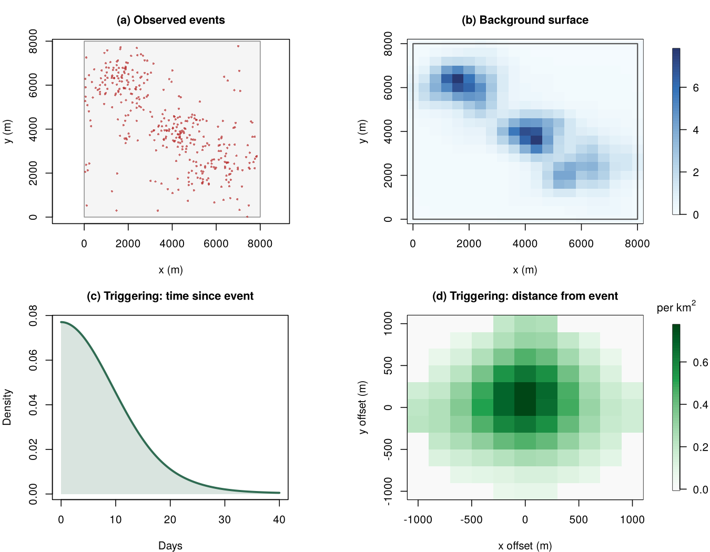
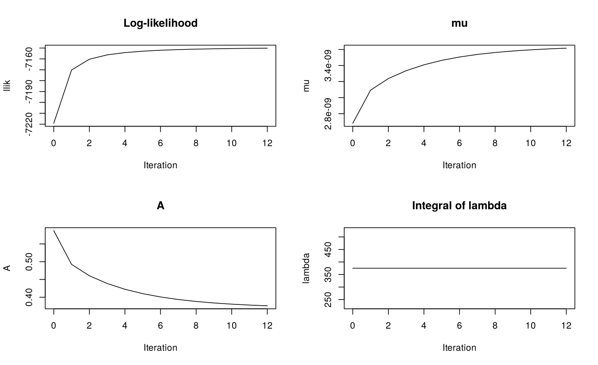

# spHawkes

Semi-parametric self-exciting (Hawkes) spatio-temporal point process
models, fit via a stochastic-declustering EM algorithm (following Zhuang
& Mateu, 2019). This package works on **any** properly projected `sf`
point dataset and study-region polygon.

The package provides:

- **Data preparation** for `sf` points and a study-region polygon, with
  checks on the coordinate reference system and the study period
  ([`prepare_events()`](https://henriquescadbylab.github.io/spHawkes/reference/prepare_events.md)).
- **Model fitting** by the EM algorithm, with non-parametric trend,
  weekly, monthly and spatial background components and non-parametric
  triggering kernels in time and space
  ([`fit_semihawkes()`](https://henriquescadbylab.github.io/spHawkes/reference/fit_semihawkes.md)).
- **Goodness-of-fit diagnostics**: time-transformed residuals, and
  residuals by calendar period and by area
  ([`gof_time_transform()`](https://henriquescadbylab.github.io/spHawkes/reference/gof_time_transform.md),
  [`gof_period_residuals()`](https://henriquescadbylab.github.io/spHawkes/reference/gof_period_residuals.md),
  [`gof_spatial_residuals()`](https://henriquescadbylab.github.io/spHawkes/reference/gof_spatial_residuals.md)).
- **Intensity maps** of the background and triggering intensity on a
  grid, as snapshots or animations
  ([`background_trigger_grid()`](https://henriquescadbylab.github.io/spHawkes/reference/background_trigger_grid.md),
  [`plot_intensity_snapshot()`](https://henriquescadbylab.github.io/spHawkes/reference/plot_intensity_snapshot.md),
  [`animate_intensity_snapshots()`](https://henriquescadbylab.github.io/spHawkes/reference/animate_intensity_snapshots.md)).
- **Uncertainty in the branching structure**: Monte Carlo samples of
  which events are background and which are triggered
  ([`sample_branching()`](https://henriquescadbylab.github.io/spHawkes/reference/sample_branching.md),
  [`sample_branching_multi()`](https://henriquescadbylab.github.io/spHawkes/reference/sample_branching_multi.md),
  [`summarize_branching_samples()`](https://henriquescadbylab.github.io/spHawkes/reference/summarize_branching_samples.md)).

## The model

The model describes the rate at which events occur at location
$`(x, y)`$ and time $`t`$, given the history $`\mathcal{H}_t`$ of events
before $`t`$. This conditional intensity is a background rate plus the
extra rate triggered by earlier events:

``` math
\lambda(x, y, t \mid \mathcal{H}_t) = \underbrace{\mu_0\, \mu_T(t)\, \mu_m(t)\, \mu_w(t)\, \mu_b(x, y)}_{\text{background}}+\underbrace{A \int_{-\infty}^{t} \int_{W} g(t - s)\, h(x - u,\, y - v)\, N(du\, dv\, ds)}_{\text{triggering}}
```

Here $`W`$ is the study region and $`N`$ is the counting measure of the
events: it puts a mass of 1 at the location $`(x_i, y_i)`$ and time
$`t_i`$ of each event, so the triggering term adds up
$`A\, g(t - t_i)\, h(x - x_i,\, y - y_i)`$ over the events $`i`$ before
$`t`$.

- **Background.** $`\mu_0`$ is a constant rate. $`\mu_T(t)`$,
  $`\mu_m(t)`$ and $`\mu_w(t)`$ multiply it by a long-term trend, a
  calendar-month effect and a day-of-week effect, each averaging 1, and
  $`\mu_b(x, y)`$ is a spatial surface that averages 1 over the study
  region.
- **Triggering.** Each earlier event $`i`$, at $`(x_i, y_i)`$ and time
  $`t_i`$, raises the rate nearby for a while. The temporal kernel $`g`$
  describes how this extra rate fades with the time since the event, and
  the spatial kernel $`h`$ how it fades with distance from it. Both
  integrate to 1, so the **branching ratio** $`A`$ is the expected
  number of events that each event triggers directly.

The model is semi-parametric: the six functions $`\mu_T`$, $`\mu_m`$,
$`\mu_w`$, $`\mu_b`$, $`g`$ and $`h`$ are estimated non-parametrically,
by kernel smoothing, while $`\mu_0`$ and $`A`$ are numerical parameters.
The EM algorithm alternates two steps until the fit settles. The E-step
computes, for each event $`i`$, the probability that it is a background
event,

``` math
\varphi_i = \frac{\mu_0\, \mu_T(t_i)\, \mu_m(t_i)\, \mu_w(t_i)\, \mu_b(x_i, y_i)}{\lambda(x_i, y_i, t_i \mid \mathcal{H}_{t_i})},
```

and, for each earlier event $`j`$, the probability that $`j`$ triggered
$`i`$,

``` math
\rho_{ij} = \frac{A\, g(t_i - t_j)\, h(x_i - x_j,\, y_i - y_j)}{\lambda(x_i, y_i, t_i \mid \mathcal{H}_{t_i})}.
```

The M-step then re-estimates every component from the events, weighted
by these probabilities.

## What it produces

A worked example on the simulated dataset bundled with the package
([`?sim_events`](https://henriquescadbylab.github.io/spHawkes/reference/sim_events.md)):
375 events over three years on an 8 km square region, drawn from a
branching process with a known branching ratio of `A = 0.35`, three
spatial hotspots, a rising trend and elevated weekends.

In a branching process every event is one of two kinds. **Background**
events arise independently of one another, at a rate that depends only
on place and time (here the hotspots, the trend and the weekend effect).
**Triggered** events are the offspring of an earlier event, and occur
near it in space and soon after it in time (for instance, events within
300 m and 5 days). Every event, of either kind, can trigger offspring of
its own, so a single background event can set off a chain.

The **branching ratio** $`A`$ is the expected number of offspring that
each event triggers directly. With $`A = 0.35`$, 100 events trigger
about 35 more, which trigger about 12 more in turn, and so on. These
generations form a geometric series, so each background event leads to
$`1/(1 - A)`$ events on average, itself included (about 1.5 here), and
in the long run a fraction $`A`$ of all events are triggered (35% here).
This needs $`A`$ below 1: an $`A`$ near 0 describes a pattern that is
almost all background, and an $`A`$ near 1 one dominated by contagion.

The fit below gives the triggering kernel a reach of 1 km from each
event, set through the kernel grid’s `x_range` and
`trigger_window_dist`. That is also the default, but the reach should be
chosen with care for every dataset: make it a few times the distance
over which one event can plausibly trigger another (here, offspring fall
a few hundred metres from their parent). A much wider reach lets the
kernel’s tail absorb clustering in the background, which inflates the
estimated branching ratio; see *Choosing the triggering reach* in
[`?fit_semihawkes`](https://henriquescadbylab.github.io/spHawkes/reference/fit_semihawkes.md).

``` r

library(spHawkes)
library(sf)

fit <- fit_semihawkes(
  points    = sim_events,
  region    = sim_region,
  date_col  = "date",
  cell_size = 400,
  cache_dir = tempfile("spHawkes_marks_"),
  bandwidth_args = list(k = 5, min_dist = 150, min_bandwidth = 300),
  trigger_window_dist  = 1000,
  trigger_spatial_args = list(x_range = 1000),
  n_iter    = 12,
  verbose   = FALSE
)
```

[`summary()`](https://rdrr.io/r/base/summary.html) reports the study
window, the estimated parameters, and how the observed events divide
between persistent background risk and contagion:

``` r

summary(fit)
#> Semi-parametric spatio-temporal Hawkes fit
#> ------------------------------------------------------------
#> Events        : 375
#> Study window  : 2021-01-03 to 2024-01-01 (1093 days)
#> CRS           : EPSG:32717
#> 
#> Parameters
#>   mu (baseline rate)     : 3.61584e-09  per unit area per day
#>   A  (branching ratio)   : 0.3758  expected offspring per event
#>   log-likelihood         : -7150.13
#> 
#> Branching structure (from fitted background probabilities)
#>   background :    252.5 events ( 67.3%)
#>   triggered  :    122.5 events ( 32.7%)
#> 
#> Fitted components (range over their support)
#>   trend               [    0.5293,      1.375]
#>   weekly              [     0.744,      1.322]
#>   monthly             [    0.9078,      1.154]
#>   spatial background  [   0.05667,       7.77]
#>   trigger (temporal)  [ 0.0004001,    0.07706]
#>   trigger (spatial)   [         0,  7.705e-07]
#> 
#> Convergence
#>   12 EM iterations, reached n_iter without converging
#>   final change in log-likelihood: 0.143031
```

Because this dataset was simulated, its generating values are known: the
branching ratio was `A = 0.35`, and 115 of the 375 realised events
(30.7%) were triggered. That share is below 35% mainly by chance,
because the number of offspring is random; a few offspring were also
discarded because they fell outside the region or after the end of the
three years. The summary above reports the fitted counterparts: an
estimated branching ratio of 0.38, and an estimated share of triggered
events of 32.7%, the average fitted probability that an event was
triggered rather than background. They need not match the generating
values exactly.

This example uses a fixed budget of 12 EM iterations. In the run shown,
the algorithm reached that limit without satisfying the convergence
criterion, so these results should be treated as an illustration rather
than a converged estimate or evidence of estimator accuracy. See
`tests/testthat/test-recovery.R` for the recovery tests.

The model decomposes risk into a **background** surface, capturing
stable place-based risk, and a **triggering** kernel, capturing how each
event raises the risk of further events nearby and soon after. Those two
things call for different responses, which is the point of separating
them.



Panel (b) is the geography of *persistent* risk; panels (c) and (d) say
how long and how far a single event’s influence extends.

Convergence over the EM iterations is shown below. The EM was capped at
12 iterations here for brevity, so the curves have not fully levelled
off; by default,
[`fit_semihawkes()`](https://henriquescadbylab.github.io/spHawkes/reference/fit_semihawkes.md)
runs up to 50 iterations and stops earlier once the log-likelihood
settles.



## Installation

Install the released state of `main` directly from GitHub:

``` r

# install.packages("remotes")
remotes::install_github("HenriquesCadbyLab/spHawkes")
```

`install_github()` does not build the vignettes by default. To install
them as well, ask for them. This needs the suggested packages, hence
`dependencies = TRUE`, and takes several minutes, because the vignettes
fit models:

``` r

remotes::install_github("HenriquesCadbyLab/spHawkes",
                        build_vignettes = TRUE, dependencies = TRUE)
```

To work on the package itself, clone it and load it in place:

``` r

# git clone https://github.com/HenriquesCadbyLab/spHawkes.git
devtools::load_all(".")   # load without installing
devtools::install(".")    # or install from the local source
```

Dependencies (`fields`, `foreach`, `ggplot2`, `patchwork`, `rlang`,
`scales`, `sf`, `spatstat.geom`, `spatstat.random`, `units`) are all on
CRAN, and `parallel` ships with R. Note that, when built from source,
`sf` needs the system GDAL, GEOS and PROJ libraries and `units` needs
udunits2; see the [`sf` installation
notes](https://r-spatial.github.io/sf/#installing) if the install fails
while compiling them.

## Usage: full pipeline

``` r

library(spHawkes)
library(sf)

# `crime_points`: an sf POINT layer with a date column, any CRS.
# `city`: an sf POLYGON/MULTIPOLYGON study-region boundary.

fit <- fit_semihawkes(
  points     = crime_points,
  region     = city,
  date_col   = "fecha_infraccion",
  cell_size  = 150,                   # spatial background grid cell size (required)
  cache_dir  = "cache/spatial_marks", # trigger_spatial_marks() cache (required)
  start_date = "2014-01-01",          # optional; defaults to earliest event date
  end_date   = "2025-01-01",          # optional; defaults to latest event date + 1
  crs        = 32717,                 # optional; defaults to the region's CRS
  bandwidth_args = list(k = 5, min_dist = 150),
  n_iter = 50,
  tol    = 0.001,
  tol_A  = 0.001,
  nprocs = 1                          # set > 1 for parallel trigger evaluation
)

print(fit)
fit$history                 # per-iteration mu, A, llik, lambda_at_all
plot(fit, which = "history")
plot(fit, which = "background")
plot(fit, which = "trigger_spatial")
```

## Usage: individual building blocks

The pipeline above is built from smaller, independently usable functions
– useful when you want to inspect or debug a single stage without
running the full EM loop:

``` r

ev <- prepare_events(
  points     = crime_points,
  region     = city,
  date_col   = "fecha_infraccion",
  start_date = "2014-01-01",
  end_date   = "2025-01-01",
  crs        = 32717
)
print(ev)   # counts kept/dropped, study period, CRS
summary(ev)

ev <- add_adaptive_bandwidth(ev, k = 5, min_dist = 150, min_bandwidth = 250)
ev <- add_bg_integral(ev, n_mc = 3000)

trend   <- temporal_base_trend(ev)
weekly  <- temporal_base_weekly(ev)
monthly <- temporal_base_monthly(ev)
background <- background_spatial(ev, cell_size = 150)

temporal_trigger <- trigger_temporal_init()
spatial_trigger  <- trigger_spatial_init()

trig <- trigger_evaluate(ev, background, temporal_trigger, spatial_trigger)
```

[`prepare_events()`](https://henriquescadbylab.github.io/spHawkes/reference/prepare_events.md)
enforces the checks that matter for reproducing this on a new dataset:

- `points` must be an `sf` object with `POINT` geometry.

- `region` must be an `sf`/`sfc` object with `POLYGON`/`MULTIPOLYGON`
  geometry.

- Both must have a CRS set, and the working CRS – the region’s, or an
  explicit `crs=` argument – must be **projected** (metres, not
  degrees): kernel bandwidths and distances throughout the package are
  in linear units. A geographic (lon/lat) working CRS raises an
  informative error telling you to
  [`sf::st_transform()`](https://r-spatial.github.io/sf/reference/st_transform.html)
  first.

- `points` is reprojected to the working CRS automatically, so it can be
  supplied in any CRS, including lon/lat.

- Events outside `region` or outside `[start_date, end_date)` are
  dropped, and the returned object reports exactly how many/why, so a
  new dataset’s filtering behaviour is easy to sanity-check.

## Learn more

The [package website](https://henriquescadbylab.github.io/spHawkes/) has
the full function reference and four articles:

- [Getting started with
  spHawkes](https://henriquescadbylab.github.io/spHawkes/articles/getting-started.html):
  the whole workflow on the simulated data, from preparing events and
  fitting the model to checking convergence, reading the fitted
  components and assessing goodness of fit.

- [Separating background risk from
  contagion](https://henriquescadbylab.github.io/spHawkes/articles/background-and-triggering.html):
  why the two call for different responses, and how to map where each
  one dominates.

- [Uncertainty quantification for the branching
  structure](https://henriquescadbylab.github.io/spHawkes/articles/branching-structure-uq.html):
  sampling which events are background and which are triggered, so that
  summaries of the two come with confidence bands instead of a single
  estimate.

- [Modelling drug-related deaths in Milwaukee
  County](https://henriquescadbylab.github.io/spHawkes/articles/milwaukee-drug-deaths.html):
  a worked example on real data, with exploratory plots, diagnostics,
  intensity maps and an animation.

The articles are also the package’s vignettes:
`browseVignettes("spHawkes")` lists them if you installed them (see
Installation above).

Beyond fitting a model, the package can:

- **Explore the data first**:
  [`plot_event_summary()`](https://henriquescadbylab.github.io/spHawkes/reference/plot_event_summary.md)
  and
  [`inspect_spatial_grid()`](https://henriquescadbylab.github.io/spHawkes/reference/inspect_spatial_grid.md).

- **Check a fit**:
  [`gof_time_transform()`](https://henriquescadbylab.github.io/spHawkes/reference/gof_time_transform.md),
  [`gof_spatial_residuals()`](https://henriquescadbylab.github.io/spHawkes/reference/gof_spatial_residuals.md)
  and
  [`gof_period_residuals()`](https://henriquescadbylab.github.io/spHawkes/reference/gof_period_residuals.md),
  each with a [`plot()`](https://rdrr.io/r/graphics/plot.default.html)
  method.

- **Map the fitted intensity**:
  [`background_trigger_grid()`](https://henriquescadbylab.github.io/spHawkes/reference/background_trigger_grid.md),
  [`plot_intensity_snapshot()`](https://henriquescadbylab.github.io/spHawkes/reference/plot_intensity_snapshot.md),
  [`animate_intensity_snapshots()`](https://henriquescadbylab.github.io/spHawkes/reference/animate_intensity_snapshots.md)
  and
  [`integrate_intensity_period()`](https://henriquescadbylab.github.io/spHawkes/reference/integrate_intensity_period.md).

- **Quantify uncertainty in the branching structure**:
  [`sample_branching_multi()`](https://henriquescadbylab.github.io/spHawkes/reference/sample_branching_multi.md)
  and
  [`summarize_branching_samples()`](https://henriquescadbylab.github.io/spHawkes/reference/summarize_branching_samples.md).

Three example datasets are bundled, each with its study region:

- `sim_events` and `sim_region`: 375 simulated events over three years
  on an 8 km square region, with known generating values.

- `crimes` and `crimes_region`: about 2,300 events simulated from a
  model fitted to open homicide data from Guayaquil, Ecuador.

- `milwaukee` and `milwaukee_county`: more than 3,000 drug-related
  deaths recorded in Milwaukee County, Wisconsin, from 2020 onwards
  (real data).

Their help pages
([`?sim_events`](https://henriquescadbylab.github.io/spHawkes/reference/sim_events.md),
[`?crimes`](https://henriquescadbylab.github.io/spHawkes/reference/crimes.md),
[`?milwaukee`](https://henriquescadbylab.github.io/spHawkes/reference/milwaukee.md))
describe how each was built and where it comes from.

The method follows [Zhuang and Mateu
(2019)](https://doi.org/10.1111/rssa.12429). To cite the package, see
`citation("spHawkes")`.

spHawkes began as a port of the R code that accompanies [D’Angelo et
al. (2024)](https://doi.org/10.1177/1471082X221094146), which implements
this method. It has since been substantially rewritten: several errors
in that code have been fixed, and its slowest computations have been
rewritten to run much faster. The model and the estimation method are
the same.

## Development

``` r

devtools::document()   # regenerate NAMESPACE/man/ from roxygen comments
devtools::test()       # run the testthat suite
devtools::check()      # full R CMD check
pkgdown::build_site()  # build the documentation site into docs/ (not committed)
```

`devtools::document()` is pinned to the roxygen2 version recorded in
`DESCRIPTION`’s `RoxygenNote`. If you regenerate the docs with a
different version, every file in `man/` will churn, so it is worth
checking that field before running it.

### Continuous integration

Three workflows run on every push to `main` and on every pull request.
All three can also be started by hand from the repository’s **Actions**
tab (`Run workflow`), and each is capped with a timeout so a stalled job
cannot run away.

| Workflow | What it does |
|----|----|
| [`R-CMD-check`](https://github.com/HenriquesCadbyLab/spHawkes/blob/main/.github/workflows/R-CMD-check.yaml) | `R CMD check --as-cran` on Linux (current R and the previous release), macOS and Windows. This is the one that has to be green. |
| [`pkgdown`](https://github.com/HenriquesCadbyLab/spHawkes/blob/main/.github/workflows/pkgdown.yaml) | Builds the documentation site. On a pull request it builds but does not publish, so a broken roxygen link or a failing example is caught before it reaches the site. |
| [`test-coverage`](https://github.com/HenriquesCadbyLab/spHawkes/blob/main/.github/workflows/test-coverage.yaml) | Runs the suite under `covr` and uploads a `coverage-report` artifact, downloadable from the run’s summary page. |

Each workflow installs GDAL, GEOS, PROJ and udunits before setting up R.
That step is only a fallback – `setup-r-dependencies` already resolves
system requirements through `pak`, and `use-public-rspm` supplies Linux
binaries – so it is bounded by a timeout and marked `continue-on-error`.
A slow package mirror will not wedge or fail a run.

### Publishing the documentation site

The `pkgdown` workflow writes the built site to a `gh-pages` branch,
which it creates on its first successful run on `main`. Serving it needs
one setting, which only a repository **admin** can change:

> **Settings -\> Pages -\> Build and deployment** Source:
> `Deploy from a branch`, Branch: `gh-pages`, Folder: `/ (root)`

Once set, the site is published at
<https://henriquescadbylab.github.io/spHawkes/>, matching the `url:`
field in `_pkgdown.yml`. Until then the workflow still runs and still
catches documentation errors – the site simply is not served.

## License

MIT – see
[`LICENSE.md`](https://github.com/HenriquesCadbyLab/spHawkes/blob/main/LICENSE.md).
